<style>
/* o trilha.css não pinta o ${...} das template literals, que herda o cinza-escuro do CSS do GitHub */
pre > code .hljs-subst { color: #9cdcfe; }
</style>

<!-- _class: capa -->

<div class="emoji">🎯</div>

# Funções Avançadas

## Aula 07 · Bloco 2 — Estruturas de Dados

<div class="meta">Funções são valores — e isso muda tudo daqui em diante</div>

---

## 🎯 Nesta aula

1. **A grande ideia:** funções são valores
2. **Arrow functions** — a sintaxe moderna, e a armadilha das chaves
3. **Callbacks** — passando comportamento
4. Parâmetros com **valor padrão**
5. **Rest e spread** — os três pontinhos

---

<!-- _class: lead -->

## 🧠 A grande ideia

Em JavaScript, uma função é **um valor como outro qualquer**.

Pode ser guardada em variável.
Pode ser colocada num array.

E — o que importa de verdade —
pode ser **passada para outra função**.

---

## Um nome, um valor



Uma variável guarda **um valor** — número, texto ou **função**. Para o JavaScript, a terceira linha não é diferente das outras duas.

---

## Função guardada em variável

```javascript
const dobrar = function (n) {
  return n * 2;
};
console.log(typeof dobrar);   // "function" — a função
console.log(dobrar(5));       // 10 — o resultado dela

const operacoes = [dobrar, function (n) { return n + 1; }];
console.log(operacoes[0](10));   // 20 — chamou a função do array
```

**`dobrar`** é a função; **`dobrar(5)`** é o que ela devolve. Os parênteses fazem a diferença — e vão importar daqui a pouco.

---

## Arrow function — a mesma função, três tamanhos

```javascript
const dobrar1 = function (n) {   // 1. function tradicional
  return n * 2;
};

const dobrar2 = (n) => {         // 2. arrow: sai "function", entra =>
  return n * 2;
};

const dobrar3 = (n) => n * 2;    // 3. enxuta: saem { } e return
```

Corpo de **uma expressão só** dispensa `{ }` e `return`.

---

## As regras da forma enxuta

| Situação | Exemplo | Parênteses |
|---|---|---|
| sem parâmetro | `() => "olá"` | obrigatórios |
| um parâmetro | `n => n * 2` | opcionais |
| dois ou mais | `(a, b) => a + b` | obrigatórios |

> 📏 **Neste curso:** arrow por padrão em variáveis e callbacks. `function` declarada continua ótima para funções principais com nome.

---

## ⚠️ Abriu chave, precisa de `return`

As quatro tentam calcular `media(6, 10)`:

```javascript
const media1 = (a, b) => (a + b) / 2;         // ✅ 8 — retorno automático
const media2 = (a, b) => {
  const soma = a + b;
  return soma / 2;                            // ✅ 8 — bloco com return
};
const media3 = (a, b) => { (a + b) / 2 };     // ❌ undefined — bloco sem return
const media4 = (a, b) => return (a + b) / 2;  // ❌ erro — return sem bloco
```

Com `{ }`, a arrow vira um bloco comum — e **bloco sem `return` devolve `undefined`**.

---

<!-- _class: lead -->

## 🔑 Callback

Uma função **passada como argumento**
para outra função executar.

É o conceito que destrava o resto do curso:

**aula 08** métodos funcionais · **aula 11** eventos · **aula 13** assincronismo

---

## Quem faz o quê



`processar` só **percorre** a lista. Quem decide **o que fazer** com cada nome é a função `acao`, que ela recebeu como argumento.

---

## Callback na prática

```javascript
function processar(lista, acao) {   // "acao" será uma função
  for (const item of lista) {
    acao(item);                     // executa o callback
  }
}

const nomes = ["Ana", "Bruno", "Carla"];
processar(nomes, (nome) => console.log(`Olá, ${nome}!`));    // Olá, Ana! …
processar(nomes, (nome) => console.log(nome.toUpperCase())); // ANA …
```

Mesmo esqueleto, dois comportamentos: **troque o callback e `processar` faz outra coisa**.

---

## Você já usou callbacks sem saber

```javascript
nums.sort((a, b) => a - b);             // o critério de ordenação é um callback
notas.forEach((n) => console.log(n));   // o que fazer com cada nota, também
```

Repare que a função vai **sem ser chamada**: você entrega a função, e quem a chama é `sort` ou `forEach`, **na hora certa**, quantas vezes precisar.

> 💡 Se `dobrar` é a função e `dobrar(5)` é o resultado, passar `dobrar(5)` como callback entregaria um **número** — e não haveria nada para chamar.

---

## A ordem do `setTimeout`



`setTimeout` **não espera**: ele agenda o callback e segue para a linha de baixo. Por que funciona assim é o assunto do **Bloco 4**.

---

## Parâmetro com valor padrão

```javascript
const semPadrao = (nome) => `Olá, ${nome}!`;
console.log(semPadrao());              // Olá, undefined!

const saudacao = (nome = "visitante") => `Olá, ${nome}!`;
console.log(saudacao("Maria"));        // Olá, Maria!
console.log(saudacao());               // Olá, visitante!
```

Parâmetro não informado chega como **`undefined`**. O valor padrão entra **só nesse caso** — e poupa um monte de `if (nome === undefined)`.

---

## `...` — um símbolo, dois papéis



O que decide o papel é **onde** os três pontinhos aparecem: na lista de **parâmetros**, é rest; numa **chamada** ou dentro de `[ ]` e `{ }`, é spread.

---

## Rest: quantos argumentos vierem

```javascript
const somarTudo = (...numeros) => {   // numeros é um array de verdade
  let total = 0;
  for (const n of numeros) total += n;
  return total;
};

console.log(somarTudo(1, 2, 3, 4, 5));   // 15
console.log(somarTudo());                // 0 — nenhum argumento, array vazio
```

A função **não precisa saber quantos** argumentos vão chegar.

---

## Spread: espalhar o que está junto

```javascript
const nums = [10, 5, 8];
console.log(Math.max(...nums));   // 10 — o mesmo que Math.max(10, 5, 8)

const a = [1, 2];
const b = [3, 4];
const juntos = [...a, ...b, 5];   // [1, 2, 3, 4, 5]

const original = { nome: "Ana", idade: 20 };
const copia = { ...original, idade: 21 };   // { nome: "Ana", idade: 21 }
```

Vale para array e para **objeto** — e é o jeito profissional de **copiar**.

---

## Copiar × apelidar

```javascript
const notas = [7, 8];
const apelido = notas;        // ❌ outro NOME para o mesmo array
const copia = [...notas];     // ✅ um array NOVO, com os mesmos valores

apelido.push(10);
console.log(notas);           // [7, 8, 10] — mudou também!
console.log(copia);           // [7, 8]
```

O `=` não copia array nem objeto: só cria **mais um nome** para a mesma estrutura.

---

## O que aconteceu na memória



`notas` e `apelido` são **dois nomes para um array só** — mexer por um é mexer pelo outro. `copia` aponta para um array novo, que ninguém tocou.

---

<!-- _class: lead -->

## ➡️ Próxima aula

**Aula 08 — Métodos Funcionais**

Você reinventou o `map` e o `filter` nos exercícios.

Agora vamos usar os oficiais.
