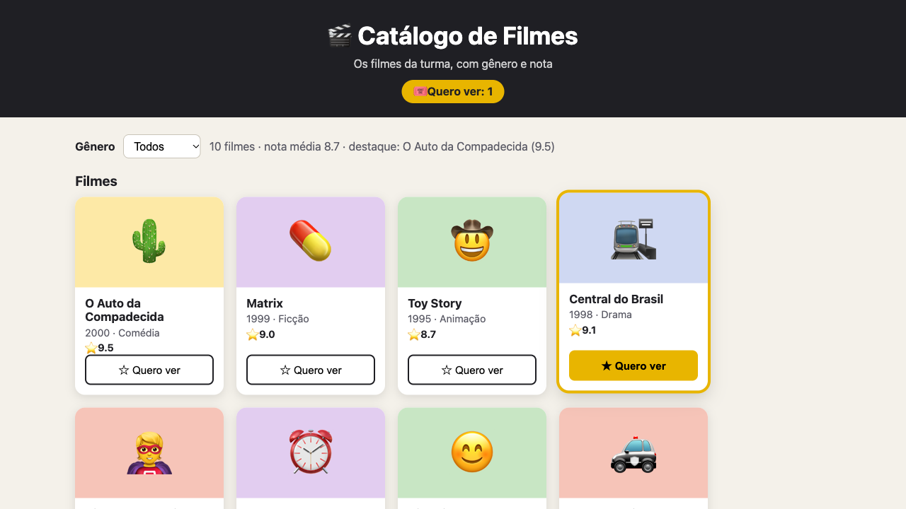
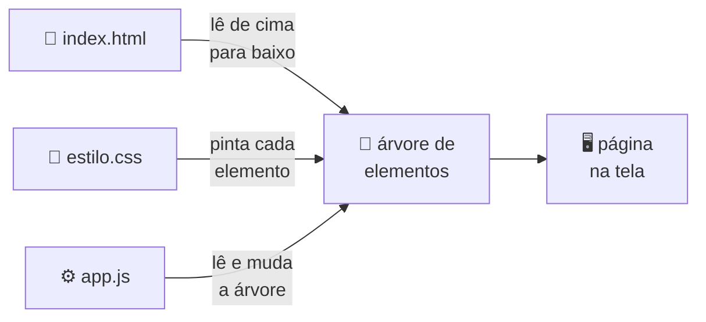
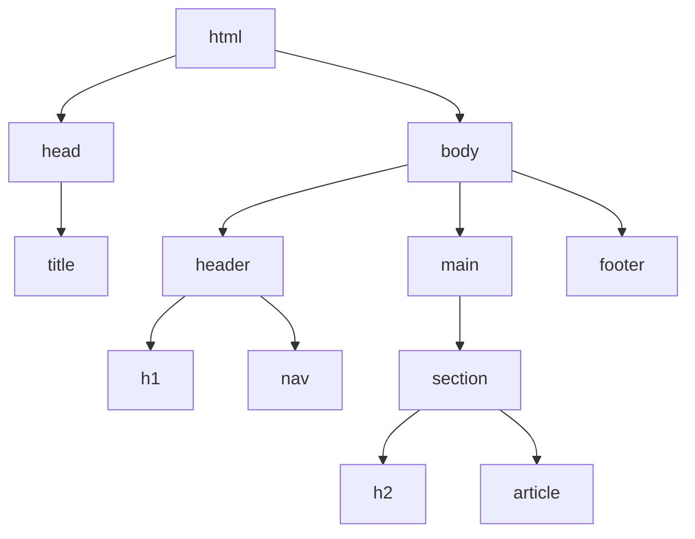
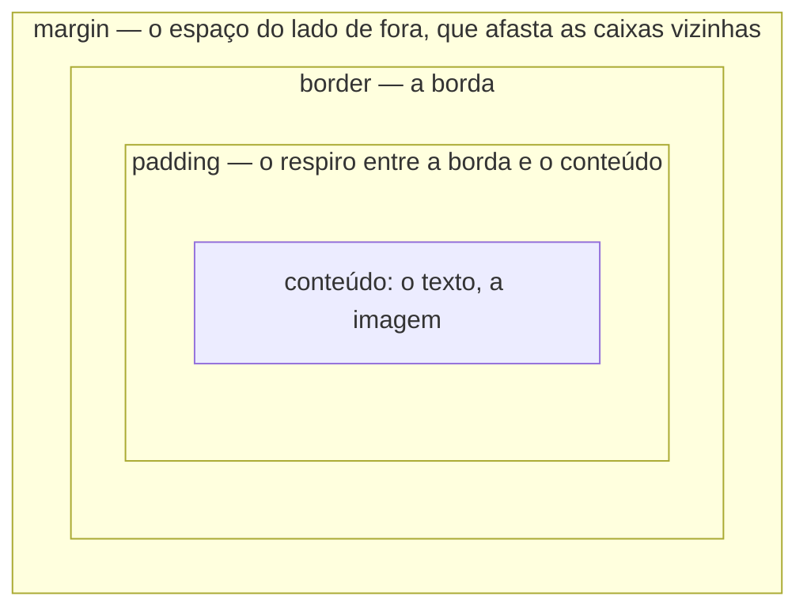
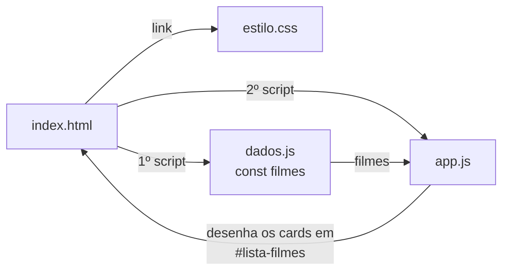

# Aula 09 — HTML + CSS + JavaScript no Navegador

> 🎯 Objetivos: entender o papel de cada linguagem da web e o caminho que o navegador faz com elas, escrever HTML com estrutura de verdade, deixar a página bonita com CSS (seletores, modelo de caixa e flexbox), rodar JavaScript no navegador e usar o DevTools como ferramenta de trabalho — e terminar com um catálogo de filmes completo funcionando.
> 🎬 Slides da aula: [apresentacao-09-html-css-js.pdf](apresentacao/apresentacao-09-html-css-js.pdf)

Até aqui, todo o seu JavaScript rodou no terminal, com o Node, e a única janela dele para o mundo era o `console.log`. Hoje ele ganha uma **página**. No fim desta aula, isto vai estar aberto no seu navegador — e você vai saber de onde vem cada pedaço:



É um catálogo de filmes com filtro por gênero, estatísticas e um botão "quero ver" em cada card. Ele é feito de **quatro arquivos curtos** — um de HTML, um de CSS e dois de JavaScript —, e boa parte do JavaScript usa só o que você já sabe do Bloco 2: arrays, objetos, `filter` e `reduce`.

O roteiro: primeiro o **trio da web** e o caminho que o navegador faz (seção 1); depois cada linguagem no seu papel — **HTML** (2), **CSS** (3) e **JavaScript** (4); a ferramenta que vai acompanhar você o bloco inteiro, o **DevTools** (5); e, por fim, o **catálogo**, peça por peça (6).

## 1. O trio da web e o caminho do navegador

Toda página da web é feita de três linguagens, e cada uma tem um papel que as outras não fazem:

| Linguagem | Papel | Analogia (casa) |
|-----------|-------|------------------|
| **HTML** | Estrutura e conteúdo: o que existe na página | Paredes, portas, cômodos |
| **CSS** | Aparência: cores, tamanhos, posições | Pintura e decoração |
| **JavaScript** | Comportamento: o que acontece quando alguém faz algo | Eletricidade: interruptores, campainha |

Repare que só a terceira é uma **linguagem de programação**. O HTML é uma linguagem de **marcação** — ele não calcula nada, só diz "isto é um título, isto é uma lista" — e o CSS é uma linguagem de **estilo**. As três se completam: um site só de HTML funciona, mas é feio e parado; o CSS deixa bonito; o JavaScript dá vida.

**O caminho do navegador.** Quando você abre um `index.html`, o navegador faz sempre o mesmo percurso:



1. **Lê o HTML** de cima para baixo e monta uma **árvore de elementos** — cada tag vira um nó, com os filhos dentro;
2. **Aplica o CSS** a cada elemento da árvore;
3. **Desenha** a página na tela;
4. Quando encontra uma tag `<script>`, **roda o JavaScript** — que pode ler a árvore e mudá-la, e a tela acompanha.

> 💡 Essa árvore tem nome — **DOM** — e é o assunto inteiro da Aula 10. Hoje basta saber que ela existe, e que é nela que o JavaScript mexe.

Neste curso o foco continua sendo o **JavaScript**. Você não precisa virar especialista em CSS; precisa entender a **estrutura do HTML**, porque é por ela que o JavaScript vai andar.

## 2. HTML: a estrutura

### O documento mínimo

Crie `aula-09/index.html` e abra-o no navegador (duplo clique no arquivo, ou botão direito → *Open with Live Server* no VS Code):

```html
<!DOCTYPE html>
<html lang="pt-BR">
<head>
  <meta charset="UTF-8" />
  <title>Minha primeira página</title>
</head>
<body>
  <h1>Olá, web!</h1>
  <p>Este é um parágrafo. HTML é feito de <strong>tags</strong>.</p>
</body>
</html>
```

| Linha | Para que serve |
|-------|----------------|
| `<!DOCTYPE html>` | Avisa que é HTML moderno. Vem sempre na primeira linha |
| `<html lang="pt-BR">` | A raiz de tudo; o `lang` diz o idioma (o leitor de tela pronuncia certo) |
| `<head>` | Informações **sobre** a página, que não aparecem nela |
| `<meta charset="UTF-8" />` | Sem ela, "ação" pode virar "ação" |
| `<title>` | O texto da aba do navegador |
| `<body>` | Tudo o que **aparece** na página |

### Tags e atributos

- **Tags** demarcam elementos: `<p>` abre e `</p>` fecha, e o conteúdo fica no meio. A maioria funciona assim, mas **algumas não têm fechamento**, porque não têm conteúdo: `<input />`, ``, `<meta />`, `<br />`;
- **Atributos** dão informações extras, sempre na tag de abertura, no formato `nome="valor"`: `type="text"`, `href="..."`, `src="..."`;
- **`id`** é o identificador **único** de um elemento — dois elementos nunca têm o mesmo `id` na mesma página;
- **`class`** é um rótulo **reutilizável**: vários elementos podem ter a mesma classe, e um elemento pode ter várias (`class="card genero-drama"`).

As tags que vamos usar o tempo todo:

| Tag | O que é |
|-----|---------|
| `<h1>` até `<h6>` | Títulos, do mais importante ao menos |
| `<p>` | Parágrafo |
| `<strong>`, `<em>` | Destaque forte (negrito) e ênfase (itálico) |
| `<ul>` / `<ol>` + `<li>` | Lista sem número / numerada, e os itens dela |
| `<a href="...">` | Link |
| `` | Imagem |
| `<button>` | Botão |
| `<input />`, `<label>`, `<select>` + `<option>` | Campos de formulário |
| `<div>`, `<span>` | Caixas genéricas, sem significado: `div` é bloco, `span` é um trecho dentro do texto |

### Estrutura semântica: cada parte com o nome certo

Dá para montar uma página inteira só com `<div>`. Mas o HTML tem tags que dizem **o que cada parte é**:

```html
<body>
  <header>              <!-- o topo: logo, título, menu -->
    <h1>🎬 Catálogo de Filmes</h1>
    <nav>               <!-- os links de navegação -->
      <a href="#filmes">Filmes</a>
    </nav>
  </header>

  <main>                <!-- o conteúdo principal (só um por página) -->
    <section>           <!-- uma seção, com tema próprio -->
      <h2>Filmes</h2>
      <article>...</article>   <!-- algo que faz sentido sozinho: um card, um post -->
    </section>
  </main>

  <footer>              <!-- o rodapé -->
    <p>Feito na Aula 09</p>
  </footer>
</body>
```

Para o navegador, `<header>` e `<div>` se desenham igual. A diferença está em quem **lê** o código: você daqui a um mês, um colega, o leitor de tela de quem não enxerga, e o buscador do Google. Todos entendem `<main>` melhor que `<div class="principal">`.

> 📏 **Regra prática:** se existe uma tag com o nome do que você está fazendo, use-a. A `<div>` é para quando nenhuma serve — por exemplo, uma caixa só para arrumar o layout.

### Uma caixa dentro da outra: a árvore

Repare na indentação do exemplo acima: cada tag fica **dentro** de outra. Isso não é enfeite — é a árvore que o navegador monta:



A família ajuda a falar dela: `body` é o **pai** de `header`, `main` e `footer`; os três são **filhos** de `body` e **irmãos** entre si; e tudo o que está dentro de `main` é **descendente** dele.

> 💡 É por essa árvore que o JavaScript vai andar na Aula 10: "pegue o `main`, ache o terceiro `article` dentro dele, troque o título". Quem enxerga a árvore no HTML chega na Aula 10 com meio caminho andado.

### Links, imagens e campos

```html
<a href="https://developer.mozilla.org/pt-BR/">Documentação da MDN</a>


<label for="campo-nome">Seu nome</label>
<input id="campo-nome" type="text" placeholder="Digite aqui" />

<label for="filtro">Gênero</label>
<select id="filtro">
  <option value="Todos">Todos</option>
  <option value="Drama">Drama</option>
</select>

<button>Enviar</button>
```

- O **`alt`** da imagem é o texto que aparece se ela não carregar, e o que o leitor de tela lê em voz alta. Imagem sem `alt` é uma página com buracos para quem não enxerga;
- O **`for`** do `<label>` aponta para o `id` do campo: clicar no rótulo põe o cursor no campo. Mais um uso do `id`;
- Os campos e o botão ainda **não fazem nada**. Na Aula 11 eles passam a reagir — por enquanto, são só estrutura.

### ✏️ Tente você

Uma página tem dois parágrafos de aviso, e o autor escreveu `<p id="aviso">` nos dois. O que está errado, e como corrigir?

<details>
<summary>Resposta</summary>

O `id` é **único**: dois elementos com o mesmo `id` quebram a regra — e, na Aula 10, o JavaScript vai encontrar só o primeiro. Como os dois parágrafos são "do mesmo tipo", o certo é uma **classe**: `<p class="aviso">` nos dois. O `id` fica para quando existe **um** de alguma coisa, como `<p id="aviso-principal">`.
</details>

### ✏️ Tente você

Escreva o HTML de um cartão de contato com tags semânticas: um bloco que faz sentido sozinho, com o nome como título, uma frase de apresentação e um link para o e-mail (`mailto:`).

<details>
<summary>Resposta</summary>

```html
<article>
  <h2>Ana Souza</h2>
  <p>Estudante de ADS, apaixonada por cinema.</p>
  <a href="mailto:ana@exemplo.com">ana@exemplo.com</a>
</article>
```

O `<article>` é a escolha certa porque o cartão faz sentido sozinho — poderia ser copiado para outra página. Com `<div>` também funcionaria, mas perderia a informação de **o que** aquele bloco é.
</details>

### ✏️ Tente você

Desenhe — com uma lista indentada, sem precisar de figura — a árvore deste trecho:

```html
<main>
  <section>
    <h2>Favoritos</h2>
    <ul>
      <li>Matrix</li>
      <li>Toy Story</li>
    </ul>
  </section>
</main>
```

<details>
<summary>Resposta</summary>

```
main
└── section
    ├── h2
    └── ul
        ├── li
        └── li
```

`section` é filho de `main`; `h2` e `ul` são irmãos; os dois `li` são filhos de `ul` e descendentes de `main`.
</details>

## 3. CSS: a aparência

### Onde o CSS mora

Há dois lugares, e o resultado é o mesmo:

- **Num bloco `<style>` dentro do `<head>`** — rápido para testar, mas o estilo fica preso àquela página;
- **Num arquivo separado**, ligado pelo `<head>` com `<link>` — o jeito profissional, e o que o catálogo usa:

```html
<head>
  <meta charset="UTF-8" />
  <title>Catálogo de Filmes</title>
  <link rel="stylesheet" href="estilo.css" />
</head>
```

Com o CSS num arquivo, dez páginas podem usar o mesmo `estilo.css` — e mudar a cor do site inteiro é mudar uma linha.

### A anatomia de uma regra

```css
h1 {                    /* seletor: QUEM recebe o estilo */
  color: darkblue;      /* propriedade: valor; */
  font-size: 2rem;
}
```

Toda regra tem um **seletor**, que diz quem recebe o estilo, e uma lista de pares **propriedade: valor**, cada um terminado em ponto e vírgula, entre chaves.

### Seletores: quem recebe o estilo

| Seletor | Pega | Exemplo |
|---------|------|---------|
| `p` | toda tag `p` | `p { line-height: 1.5; }` |
| `.card` | todo elemento com `class="card"` | `.card { border-radius: 14px; }` |
| `#lista-filmes` | o elemento com `id="lista-filmes"` | `#lista-filmes { gap: 18px; }` |
| `.card h3` | todo `h3` que está **dentro** de um `.card` | `.card h3 { font-size: 1.05rem; }` |
| `.card:hover` | o `.card` **enquanto o mouse está em cima** | `.card:hover { transform: translateY(-6px); }` |

> 📏 **Ponto para classe, cerquilha para id:** `.nome` seleciona pela `class`, `#nome` seleciona pelo `id`. Essa mesma notação volta na Aula 10, quando o JavaScript procurar elementos na página — guarde-a bem.

O `:hover` é o primeiro "comportamento" que o CSS sabe fazer sozinho, sem JavaScript: passe o mouse num card do catálogo e ele sobe.

### Cores, fontes e tamanhos

```css
body {
  font-family: system-ui, sans-serif;   /* a fonte do sistema; se faltar, qualquer uma sem serifa */
  color: #1f1f24;                       /* cor do texto */
  background-color: #f4f1ea;            /* cor do fundo */
}

.subtitulo {
  font-size: 1rem;          /* rem = em relação ao tamanho base da página (16px) */
  font-weight: bold;
  text-align: center;
  opacity: 0.8;             /* 80% visível */
}
```

Uma cor pode ser escrita pelo **nome** (`darkblue`), em **hexadecimal** (`#e8b500`: vermelho, verde e azul, de `00` a `ff`) ou com **`rgb()`** (`rgb(232, 181, 0)` — a mesma cor). Para tamanhos, `px` é um tamanho fixo e `rem` acompanha o tamanho de letra que a pessoa escolheu no navegador.

### O modelo de caixa

Para o CSS, **todo elemento é uma caixa** — até uma palavra em negrito. E toda caixa tem quatro camadas, de dentro para fora:



```css
.card {
  width: 210px;
  padding: 14px;              /* respiro de dentro, nos 4 lados */
  border: 2px solid #1f1f24;  /* espessura, estilo, cor */
  margin: 10px;               /* distância das outras caixas */
  border-radius: 14px;        /* cantos arredondados */
}
```

> ⚠️ **A conta da largura engana.** Por padrão, o `width` vale só para o **conteúdo**: o card acima ocupa 210 + 14 + 14 + 2 + 2 = **242px** na tela. A linha `* { box-sizing: border-box; }`, no começo do CSS, muda a conta para o que todo mundo espera — o `width` passa a incluir o `padding` e a borda. Quase todo site profissional começa com ela, e o catálogo também.

### Flexbox: caixas lado a lado

Por padrão, cada `<div>`, `<section>` ou `<article>` ocupa a linha inteira, e as caixas ficam empilhadas. Para pô-las **lado a lado**, o **pai** ganha `display: flex`:

```css
.lista {
  display: flex;             /* os filhos ficam lado a lado */
  flex-wrap: wrap;           /* não coube? quebra para a linha de baixo */
  gap: 18px;                 /* espaço entre os filhos */
}
```

| Propriedade (no pai) | O que faz |
|----------------------|-----------|
| `display: flex` | Liga o flexbox: os filhos viram uma fila |
| `flex-direction` | `row` (fila, o padrão) ou `column` (coluna) |
| `gap` | Espaço entre os filhos |
| `justify-content` | Onde a fila fica no eixo dela: `flex-start`, `center`, `space-between` |
| `align-items` | Como os filhos se alinham no outro eixo: `center`, `stretch` |
| `flex-wrap: wrap` | Deixa a fila quebrar em várias linhas |

É exatamente assim que os cards do catálogo se arrumam: numa tela larga cabem quatro por linha; num celular, um embaixo do outro — **sem uma linha de JavaScript**.

> 💡 **Variáveis no CSS.** O catálogo declara as cores uma vez só, no começo do arquivo, e usa os nomes no resto:
>
> ```css
> :root {
>   --cor-destaque: #e8b500;
> }
> .quero-ver {
>   background-color: var(--cor-destaque);
> }
> ```
>
> Trocar `--cor-destaque` muda a cor em todos os lugares que a usam. É o primeiro exercício de visual que você vai fazer.

### ✏️ Tente você

Escreva o seletor que pega: (a) todos os parágrafos; (b) os elementos com `class="aviso"`; (c) o elemento com `id="topo"`; (d) só os `h3` que estão dentro de um `.card`.

<details>
<summary>Resposta</summary>

(a) `p`; (b) `.aviso`; (c) `#topo`; (d) `.card h3` — com espaço entre os dois, que significa "dentro de".
</details>

### ✏️ Tente você

Um card tem `width: 210px`, `padding: 14px` e `border: 2px solid`. Quantos pixels de largura ele ocupa na tela **sem** `box-sizing: border-box`? E **com**?

<details>
<summary>Resposta</summary>

**Sem:** 210 + 14 + 14 + 2 + 2 = **242px** — o `padding` e a borda entram dos dois lados, por fora do `width`. **Com** `border-box`: **210px**, porque o `padding` e a borda passam a caber dentro dos 210, e o conteúdo encolhe para 178px.
</details>

### ✏️ Tente você

Você tem uma `<div class="botoes">` com três botões dentro. Escreva o CSS que os deixa lado a lado, centralizados, com 12px de espaço entre eles.

<details>
<summary>Resposta</summary>

```css
.botoes {
  display: flex;
  justify-content: center;
  gap: 12px;
}
```

O estilo vai no **pai** (`.botoes`), e não nos botões: no flexbox, quem organiza a fila é o contêiner.
</details>

## 4. JavaScript entra em cena

### A tag `<script>`

O JavaScript entra na página pela tag `<script>`, apontando para um arquivo `.js`, **por convenção no final do `<body>`**:

```html
<body>
  <h1>Página com JS</h1>
  <p>Conteúdo da página...</p>

  <script src="script.js"></script>
</body>
```

O motivo é o caminho do navegador da seção 1: ele lê o HTML **de cima para baixo**. Quando chega ao `<script>`, no final, todo o HTML acima **já existe** na árvore — e o JavaScript pode encontrar qualquer elemento. Com o `<script>` no `<head>`, ele rodaria antes de o `<body>` existir.

Crie `aula-09/script.js` na mesma pasta do `index.html`:

```javascript
console.log("O JavaScript está rodando no navegador!");
alert("Olá! Eu vim do script.js 👋");
```

Recarregue a página: o `alert` aparece numa janela. E o `console.log`? **Não aparece na página.** Ele foi para o Console do navegador — a seção 5 mostra onde fica.

### Vários scripts: a ordem importa

Uma página pode ter quantos `<script>` quiser, e eles rodam **na ordem em que aparecem**. Tudo o que um script declara no nível de cima — uma `const`, uma função — fica visível para os scripts **seguintes**. O catálogo usa isso:

```html
<script src="dados.js"></script>   <!-- declara: const filmes = [...] -->
<script src="app.js"></script>     <!-- usa: filmes -->
```

Inverta as duas linhas e a página abre **vazia**, com este erro no Console:

```
Uncaught ReferenceError: filmes is not defined      app.js:133
```

O `app.js` rodou primeiro e procurou um `filmes` que ainda não existia. É o mesmo `ReferenceError` que você já viu no Node — com a vantagem de que o navegador diz o arquivo e a linha.

### Falando com o usuário: `alert`, `prompt` e `confirm`

O navegador traz três funções prontas que abrem uma janela e **param a página** até a pessoa responder:

```javascript
alert("Bem-vindo ao catálogo!");             // só avisa; devolve undefined

const nome = prompt("Qual é o seu nome?");   // devolve o texto digitado (string)
                                             // ou null, se clicar em Cancelar

const certeza = confirm("Apagar a lista?");  // devolve true (OK) ou false (Cancelar)
```

| | `console.log("oi")` | `alert("oi")` |
|---|---|---|
| Onde aparece | No **Console** do DevTools | Numa **janela** sobre a página |
| Para quem | Para quem **desenvolve** | Para quem **usa** o site |
| Para a página? | Não | Sim, até clicarem em OK |

São úteis para testar, mas pouco usadas em site de verdade — ninguém gosta de janela pulando na frente. Na Aula 11 a conversa com o usuário vai ser do jeito profissional, com campo e botão na própria página.

### Todo o JavaScript que você aprendeu continua valendo

Variáveis, funções, arrays, objetos, `map`, `filter`, `reduce` — **tudo igual**. Estas duas funções são do catálogo e rodam tanto no navegador quanto no Node, porque não mexem na página, só calculam:

```javascript
const filmesDoGenero = (lista, genero) => {
  if (genero === "Todos") return [...lista];
  return lista.filter((filme) => filme.genero === genero);
};

const mediaDasNotas = (lista) => {
  if (lista.length === 0) return 0;
  const soma = lista.reduce((total, filme) => total + filme.nota, 0);
  return soma / lista.length;
};

console.log(filmesDoGenero(filmes, "Drama").length);              // 2
console.log(mediaDasNotas(filmes));                               // 8.72
console.log(mediaDasNotas(filmesDoGenero(filmes, "Animação")));   // 8.6
```

O que muda no navegador é que, além do `console.log`, o JavaScript pode **mexer na página**. Esse é o assunto das Aulas 10 e 11 — e o catálogo dá uma prévia.

### ✏️ Tente você

O arquivo `utilidades.js` tem `const dobro = (n) => n * 2;` e o `principal.js` tem `console.log(dobro(21));`. Em que ordem as duas tags `<script>` precisam aparecer, e o que sai no Console?

<details>
<summary>Resposta</summary>

```html
<script src="utilidades.js"></script>
<script src="principal.js"></script>
```

Primeiro quem **declara**, depois quem **usa**. O Console mostra `42`. Na ordem inversa, aparece `Uncaught ReferenceError: dobro is not defined`.
</details>

### ✏️ Tente você

O usuário digita `25` no `prompt` abaixo. O que aparece no Console?

```javascript
const idade = prompt("Quantos anos você tem?");
console.log(idade + 1);
```

<details>
<summary>Resposta</summary>

Aparece **`251`**. O `prompt` sempre devolve **texto**, e texto `+` número é concatenação — a coerção da Aula 02 de volta. Para somar de verdade: `Number(idade) + 1`, que dá `26`. Essa mesma armadilha vai aparecer na Aula 11, com o valor dos campos.
</details>

## 5. DevTools — sua nova casa

Aperte **F12** (ou botão direito → *Inspecionar*). O painel que abre é o **DevTools**, e duas abas dele vão acompanhar você até o fim do curso.

### A aba Console

- É para lá que vão os `console.log` **e os erros**, com a mensagem, o arquivo e a linha — clique no nome do arquivo e o DevTools mostra a linha exata;
- Ela também **executa JavaScript na hora**, na própria página. Experimente:

```javascript
2 + 2                              // 4
document.title                     // o texto da aba
document.title = "Novo título"     // olhe a aba do navegador mudar
window.innerWidth                  // a largura da janela, em pixels
```

O **`document`** é a página inteira, vista pelo JavaScript; o **`window`** é a janela (ou a aba) do navegador. As funções da seção 4 são dele: `alert` é, na verdade, `window.alert`.

- No catálogo, o Console enxerga tudo o que os scripts declararam: digite `filmes` e veja o array; chame `filmesDoGenero(filmes, "Comédia")` ou `melhorFilme(filmes)`.

> 📏 **Regra do Bloco 3:** deu problema? **Primeiro passo: abrir o Console.** O erro estará lá, com arquivo e linha, exatamente como no Node. Página em branco, botão que não faz nada, card que não aparece: antes de mexer em qualquer código, leia o Console.

### A aba Elements

- Mostra o HTML **vivo** — a árvore da seção 2, com os triângulos para abrir cada nó. Passe o mouse sobre uma linha e o elemento acende na página, com o `padding` e a `margin` coloridos: é o **modelo de caixa** desenhado na tela;
- Dá para **editar ao vivo**: clique duas vezes num texto e troque-o; no painel *Styles*, à direita, ligue e desligue propriedades, ou mude valores com as setas do teclado;
- Tudo o que você muda ali **some ao recarregar** a página. É um laboratório: teste no DevTools, e só depois leve para o `estilo.css` o que deu certo.

### ✏️ Tente você

Com o catálogo aberto, use só o Console para descobrir: quantos filmes de Drama existem, e qual é a nota média das animações?

<details>
<summary>Resposta</summary>

```javascript
filmesDoGenero(filmes, "Drama").length                // 2
mediaDasNotas(filmesDoGenero(filmes, "Animação"))     // 8.6
```

Repare que as funções aceitam ser combinadas — o resultado de uma vira a entrada da outra, como no encadeamento da Aula 08.
</details>

### ✏️ Tente você

Na aba Elements, selecione o `<html>`, procure `--cor-destaque` no painel *Styles* e troque o valor por `crimson`. O que muda na página? E o que acontece quando você recarrega?

<details>
<summary>Resposta</summary>

Muda tudo o que usa `var(--cor-destaque)`: a pílula "Quero ver" do cabeçalho, a borda do card marcado e o botão dele. Ao recarregar, volta o amarelo — a mudança estava só na página aberta, e não no arquivo. Para ficar, a nova cor precisa ir para o `estilo.css`.
</details>

## 6. Juntando tudo: o catálogo de filmes

### Como pegar o app

O catálogo está em [`exemplos/catalogo-filmes/`](exemplos/catalogo-filmes/), no repositório do curso. Para levar para o **seu** repositório:

1. Na página do repositório do curso, no GitHub, clique em **Code → Download ZIP** e descompacte;
2. Copie a pasta `bloco-3-navegador-dom/aula-09-html-css-js/exemplos/catalogo-filmes/` para dentro da sua `aula-09/`, com o nome `catalogo/`;
3. Abra `catalogo/index.html` com **duplo clique**. Não precisa de internet nem de instalar nada.

Prefere não baixar o ZIP? Abra cada um dos quatro arquivos no GitHub, clique em **Raw**, e copie o conteúdo para um arquivo com o mesmo nome.

### Os quatro arquivos

| Arquivo | Linguagem | O que faz | Você já sabe? |
|---------|-----------|-----------|---------------|
| [`index.html`](exemplos/catalogo-filmes/index.html) | HTML | A estrutura: cabeçalho, filtro, área dos cards, rodapé | ✅ seção 2 |
| [`estilo.css`](exemplos/catalogo-filmes/estilo.css) | CSS | O visual: cores, cards, flexbox, `:hover` | ✅ seção 3 |
| [`dados.js`](exemplos/catalogo-filmes/dados.js) | JavaScript | Os filmes: um array de objetos | ✅ Aulas 05 e 06 |
| [`app.js`](exemplos/catalogo-filmes/app.js) | JavaScript | Parte 1: as contas. Parte 2: desenhar e reagir | ✅ parte 1 · 🔮 parte 2 |

Como eles se ligam:



### O `index.html`: o esqueleto

```html
<header class="topo">
  <h1>🎬 Catálogo de Filmes</h1>
  <p class="subtitulo">Os filmes da turma, com gênero e nota</p>
  <p class="quero-ver">🎟️ Quero ver: <span id="contador-quero-ver">0</span></p>
</header>

<main>
  <section class="barra">
    <label for="filtro-genero">Gênero</label>
    <select id="filtro-genero">
      <option value="Todos">Todos</option>
      <option value="Ação">Ação</option>
      <!-- ... uma opção para cada gênero -->
    </select>
    <p id="estatisticas"></p>
  </section>

  <section class="filmes">
    <h2>Filmes</h2>
    <div id="lista-filmes" class="lista"></div>
  </section>
</main>
```

Repare em duas coisas. A `<div id="lista-filmes">` está **vazia**: os cards não estão no HTML — quem os cria é o `app.js`, a partir dos dados. E os elementos que o JavaScript vai usar têm **`id`**: o filtro, a área dos cards, as estatísticas e o contador.

### O `estilo.css`: o visual

As partes que você já reconhece da seção 3:

```css
:root {
  --cor-destaque: #e8b500;        /* o amarelo do JavaScript */
}

.lista {
  display: flex;                  /* os cards lado a lado... */
  flex-wrap: wrap;                /* ...quebrando a linha quando não cabem */
  gap: 18px;
}

.card:hover {                     /* o card sobe quando o mouse passa */
  transform: translateY(-6px);
}

.genero-drama  .poster { background-color: #cfd8f2; }
.genero-outro  .poster { background-color: #e3e3e3; }   /* gênero que o CSS não conhece */
```

Cada gênero tem uma classe com uma cor de pôster. Um card de drama recebe `class="card genero-drama"` — duas classes no mesmo elemento, uma para o formato e outra para a cor.

### O `dados.js`: um array de objetos

```javascript
// dados.js (trecho)
const filmes = [
  { titulo: "O Auto da Compadecida", ano: 2000, genero: "Comédia", nota: 9.5, emoji: "🌵" },
  { titulo: "Matrix", ano: 1999, genero: "Ficção", nota: 9.0, emoji: "💊" },
  { titulo: "Central do Brasil", ano: 1998, genero: "Drama", nota: 9.1, emoji: "🚉" },
  // ... dez filmes ao todo
];
```

Nada de novo: é o array de objetos das Aulas 05 e 06. A nota é a do catálogo, e não uma avaliação oficial. **Trocar os filmes daqui é trocar o que aparece na página** — o primeiro exercício.

### O `app.js`, parte 1: o que você já sabe

A primeira metade do arquivo são funções que **só calculam**: `filmesDoGenero` e `mediaDasNotas`, que você viu na seção 4, e mais três:

```javascript
// app.js (trecho)
const melhorFilme = (lista) => {
  if (lista.length === 0) return null;
  return lista.reduce((melhor, filme) => (filme.nota > melhor.nota ? filme : melhor));
};

const classesDosGeneros = { "Ação": "genero-acao", "Drama": "genero-drama", /* ... */ };
const classeDoGenero = (genero) => classesDosGeneros[genero] || "genero-outro";

const contarQueroVer = (lista) => lista.filter((filme) => filme.queroVer).length;
```

O `reduce` da Aula 08 com o ternário da Aula 03, e um objeto como tabela de consulta (Aula 06). O `||` da última linha é o "OU" da Aula 03 num uso novo: se o gênero não está na tabela, o lado esquerdo vem vazio (`undefined`), e vale o da direita, `"genero-outro"`. Todas funcionam no Console.

### O `app.js`, parte 2: 🔮 a prévia

A segunda metade começa com um aviso bem visível — `🔮 PRÉVIA DAS AULAS 10 E 11 — não precisa entender agora` — e faz três coisas:

1. **Encontra** na página os elementos que têm `id` (o filtro, a área dos cards, as estatísticas e o contador);
2. **Cria** um card para cada filme, no padrão criar → configurar → inserir:

```javascript
// app.js (trecho)
const criarCard = (filme) => {
  const card = document.createElement("article");        // criar
  card.classList.add("card");                            // configurar
  card.classList.add(classeDoGenero(filme.genero));      // ← a função da parte 1!
  // ... o pôster, o título, o ano, a nota e o botão, do mesmo jeito
  return card;
};
```

3. **Reage** ao que a pessoa faz — escolher um gênero no menu, clicar em "quero ver":

```javascript
// app.js (trecho)
filtroGenero.addEventListener("change", () => {
  mostrarFilmes(filmesDoGenero(filmes, filtroGenero.value));   // ← a parte 1 de novo
});
```

Você não precisa entender cada linha disso hoje — **a Aula 10 ensina a encontrar e criar elementos, e a Aula 11, a reagir a cliques**. Mas repare na divisão de trabalho: a parte 2 nunca faz conta. Quem decide quais filmes aparecem e qual é a média é a parte 1, com o JavaScript que você já domina. A parte 2 só mostra o resultado.

> 💡 **Estado → evento → tela.** Quando você clica em "quero ver", o código muda um **dado** (`filme.queroVer`), e a **tela** acompanha: o card fica amarelo e o contador sobe. Filtre outro gênero e volte: o card continua marcado, porque a marcação mora no dado, e não no desenho. É o padrão de quase todo app — da lista de tarefas ao Instagram — e o fio das Aulas 10, 11 e 12.

### Brincando pelo Console

Com o catálogo aberto e o Console à mostra, experimente:

```javascript
filmes.length                                   // 10
melhorFilme(filmes).titulo                      // "O Auto da Compadecida"
filmesDoGenero(filmes, "Comédia")               // os dois filmes de comédia
classeDoGenero("Terror")                        // "genero-outro"
mostrarFilmes(filmesDoGenero(filmes, "Drama"))  // a página passa a mostrar só os dramas
```

A última linha usa uma função da parte 2 para redesenhar a página com o resultado de uma função da parte 1 — escrita por você, à mão, no Console.

## 🏋️ Exercícios da aula

Na pasta `aula-09/`:

1. **`sobre-mim/`** — Do zero, sem copiar o catálogo: crie `index.html` e `estilo.css` com uma mini página pessoal. Use `header` (seu nome num `h1`), `main` com duas `section` (uma de apresentação, com um parágrafo; outra com uma lista de 3 hobbies) e `footer`. No CSS, use ao menos uma variável de cor, uma caixa com `padding`, borda e `border-radius`, os hobbies lado a lado com flexbox e um efeito de `:hover`;
2. **`catalogo/` — os seus filmes:** copie o catálogo (seção 6) e, no `dados.js`, troque ao menos 3 filmes pelos seus favoritos, usando os cinco gêneros conhecidos. Confira se as estatísticas mudaram. Depois, acrescente um filme com o gênero `"Terror"` e observe onde ele aparece e de que cor. Explique, num comentário no fim do `dados.js`, por que ele aparece em "Todos" mas não tem opção no filtro, e por que ganhou a cor cinza;
3. **`catalogo/` — o seu visual:** mude a paleta pelas variáveis do `:root`, troque o efeito do `:hover` e deixe os cards mais largos. Teste cada mudança antes na aba Elements e só então salve no `estilo.css`, com um comentário `/* mudei: ... */` em cada regra alterada;
4. **No Console:** com o seu catálogo aberto, rode `filmes.length`, `melhorFilme(filmes)`, `filmesDoGenero(filmes, "Ação")` e `document.title = "Meu catálogo"`. Depois, troque a ordem dos dois `<script>` no `index.html`, recarregue, e anote num comentário no topo do `app.js` a mensagem de erro e a linha que o Console mostrou. Desfaça a troca;
5. **Desafio 🌶️** — Na parte 1 do `app.js`, escreva a função `filmesDaDecada(lista, decada)`, que devolve os filmes de uma década (`filmesDaDecada(filmes, 1990)` → os filmes de 1990 a 1999). Teste no Console. Só vale o que você já sabe do Bloco 2 — e, se quiser ir além, mostre o resultado na página com `mostrarFilmes(filmesDaDecada(filmes, 1990))`.

### 📤 Entrega

Estes exercícios são feitos em sala e vão para o **seu repositório** `exercicios-javascript`:

```bash
cd ..                 # da pasta da aula para a raiz do repositório
git add aula-09/
git commit -m "Resolve exercícios da aula 09"
git push
```

Confira no navegador que a pasta apareceu em `github.com/SEU-USUARIO/exercicios-javascript`.

## 🧠 Revisão

[8 questões de múltipla escolha](revisao/README.md) para conferir se os conceitos ficaram sólidos. Responda sem consultar a aula — depois volte e corrija.

---

⬅️ [Aula 08](../../bloco-2-estruturas/aula-08-metodos-funcionais/README.md) | ➡️ [Aula 10 — DOM](../aula-10-dom/README.md)
