<style>
/* o trilha.css não pinta o ${...} das template literals, que herda o cinza-escuro do CSS do GitHub */
pre > code .hljs-subst { color: #9cdcfe; }

/* o modelo de caixa, com as cores que o DevTools usa na aba Elements */
.bm { padding: 10px 26px 16px; font-size: 22px; font-weight: bold; color: #1a1a1a; }
.bm-margin  { background: #f9cc9d; width: 760px; margin: 6px auto 0; }
.bm-border  { background: #fddd9b; }
.bm-padding { background: #c3d08b; }
.bm-conteudo { background: #8cb6c0; text-align: center; padding: 22px; }
.bm span { font-weight: normal; }
</style>

<!-- _class: capa -->

<div class="emoji">🌐</div>

# HTML + CSS + JavaScript

## Aula 09 · Bloco 3 — O Navegador e o DOM

<div class="meta">Seu código ganha uma tela</div>

---

## 🎬 No fim desta aula


Um catálogo de filmes com filtro, estatísticas e "quero ver" — feito com **quatro arquivos curtos**.

---

## O trio da web

| Linguagem | Papel | Na casa |
|-----------|-------|---------|
| **HTML** | Estrutura e conteúdo: o que existe | Paredes e cômodos |
| **CSS** | Aparência: cores, tamanhos, posições | Pintura e decoração |
| **JavaScript** | Comportamento: o que acontece | A eletricidade |

Só o JavaScript é linguagem de **programação**. O HTML **marca** o conteúdo, e o CSS dá o **estilo**.

---

## O caminho do navegador



O navegador lê o HTML **de cima para baixo**, monta uma árvore, pinta com o CSS e desenha. O JavaScript age **sobre a árvore** — e a tela acompanha.

---

## O documento mínimo

```html
<!DOCTYPE html>
<html lang="pt-BR">
<head>
  <meta charset="UTF-8" />
  <title>Catálogo de Filmes</title>
</head>
<body>
  <h1>🎬 Catálogo de Filmes</h1>
  <p>Os filmes da turma, com gênero e nota.</p>
</body>
</html>
```

O `<head>` fala **sobre** a página; o `<body>` é o que **aparece** nela.

---

## Tags, atributos, `id` e `class`

```html
<p class="aviso">Primeiro aviso</p>
<p class="aviso">Segundo aviso</p>
<input id="campo-nome" type="text" placeholder="Seu nome" />
```

A maioria das tags **abre e fecha**; algumas, como `<input />`, não têm fechamento.

O `id` é **único** na página. A `class` é **reutilizável**: vários elementos com o mesmo rótulo.

---

## Cada parte com o nome certo

```html
<header> <h1>🎬 Catálogo de Filmes</h1> </header>
<main>
  <section>
    <h2>Filmes</h2>
    <article>um card</article>
  </section>
</main>
<footer> <p>Feito na Aula 09</p> </footer>
```

Para o navegador, `<header>` e `<div>` se desenham igual. A diferença está em quem **lê**: você, um colega, o leitor de tela, o buscador.

---

## Uma caixa dentro da outra



`body` é o **pai** de `header`, `main` e `footer`. Na Aula 10, o JavaScript anda por esta árvore.

---

## A anatomia de uma regra CSS

```css
.card h3 {               /* seletor: QUEM recebe o estilo */
  color: #1f1f24;        /* propriedade: valor; */
  font-size: 1.05rem;
}
```

O CSS mora num arquivo próprio, ligado no `<head>`:

```html
<link rel="stylesheet" href="estilo.css" />
```

Dez páginas podem usar o mesmo `estilo.css` — e mudar a cor do site é mudar uma linha.

---

## Seletores: quem recebe o estilo

| Seletor | Pega |
|---------|------|
| `p` | toda tag `p` |
| `.card` | todo elemento com `class="card"` |
| `#lista-filmes` | o elemento com `id="lista-filmes"` |
| `.card h3` | todo `h3` **dentro** de um `.card` |
| `.card:hover` | o `.card` **enquanto o mouse está em cima** |

**Ponto para classe, cerquilha para id** — a mesma notação volta na Aula 10.

---

## O modelo de caixa

<div class="bm bm-margin">margin <span>— afasta as vizinhas</span>
<div class="bm bm-border">border <span>— a borda</span>
<div class="bm bm-padding">padding <span>— o respiro de dentro</span>
<div class="bm bm-conteudo">conteúdo</div>
</div>
</div>
</div>

Todo elemento é uma caixa. Por padrão, o `width` vale só para o conteúdo — por isso o catálogo começa com `box-sizing: border-box`.

---

## Flexbox: caixas lado a lado

```css
.lista {
  display: flex;      /* os filhos ficam lado a lado */
  flex-wrap: wrap;    /* não coube? quebra a linha */
  gap: 18px;          /* espaço entre eles */
}
```

O estilo vai no **pai**, e os filhos se arrumam sozinhos.

Tela larga: quatro cards por linha. Celular: um embaixo do outro — **sem uma linha de JavaScript**.

---

## `<script>` no final do `<body>`

```html
<body>
  <h1>🎬 Catálogo de Filmes</h1>
  <div id="lista-filmes"></div>

  <script src="app.js"></script>
</body>
```

O navegador lê de cima para baixo. Quando chega ao `<script>`, todo o HTML acima **já existe** — e o JavaScript encontra o que precisar.

---

## Vários scripts: a ordem importa

```html
<script src="dados.js"></script>   <!-- declara: const filmes -->
<script src="app.js"></script>     <!-- usa: filmes -->
```

Com as duas linhas invertidas, a página abre vazia, e o Console mostra:

```
Uncaught ReferenceError: filmes is not defined      app.js:133
```

Primeiro quem **declara**, depois quem **usa**.

---

## Falando com o usuário

```javascript
alert("Bem-vindo ao catálogo!");             // janela; a página para
const nome = prompt("Qual é o seu nome?");   // o texto digitado, ou null
const ok = confirm("Apagar a lista?");       // true ou false
console.log(`Olá, ${nome}!`);                // vai para o Console
```

O `alert` é para quem **usa** o site. O `console.log` é para quem **desenvolve**: ele nunca aparece na página.

---

## DevTools — sua nova casa

**Console (F12):** os `console.log`, os erros com arquivo e linha, e JavaScript na hora — experimente `document.title = "Novo título"`.

**Elements:** o HTML vivo, a caixa de cada elemento acesa na página, e o CSS editável ao vivo. Tudo some ao recarregar: teste ali, salve no arquivo.

> 📏 **Regra do Bloco 3:** deu problema? Primeiro passo: **abrir o Console**.

---

## O catálogo: quatro arquivos



O HTML liga o CSS e os dois scripts — **primeiro os dados, depois quem os usa**.

---

## O `app.js` em duas partes

```javascript
// 1. O QUE VOCÊ JÁ SABE — só calcula
const filmesDoGenero = (lista, genero) => {
  if (genero === "Todos") return [...lista];
  return lista.filter((filme) => filme.genero === genero);
};

// 2. 🔮 PRÉVIA DAS AULAS 10 E 11 — mexe na página
filtroGenero.addEventListener("change", () => {
  mostrarFilmes(filmesDoGenero(filmes, filtroGenero.value));
});
```

A parte 2 nunca faz conta: quem decide o que aparece é a parte 1.

---

## Estado → evento → tela


Clicar em "quero ver" muda um **dado** (`filme.queroVer`), e a **tela** acompanha. É o padrão de quase todo app — e o fio das Aulas 10, 11 e 12.

---

<!-- _class: lead -->

## ➡️ Próxima aula

**Aula 10 — DOM**

O JavaScript deixa de só *observar* a página
e passa a **controlá-la**.

É a parte 2 do `app.js` que você vai aprender a escrever.
